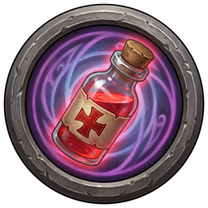

<p align="center">
  
</p>

# BestPotion

A lightweight **World of Warcraft: Forever** (`Interface: 16001`) addon that gives you two dynamic action bar shortcuts — one for your best usable **Healing Potion** and one for your best usable **Mana Potion** in your bags.

## Features

- **Native action bar shortcuts**: Maintains two managed WoW macros (`BestHealPot` and `BestManaPot`) using `#showtooltip` and `/use item:<id>`, giving you native icons, stack counts, cooldown sweeps, tooltips, keybinds, and combat usability.
- **Level & usability aware**: Automatically skips potions whose required level exceeds your character's level, class-restricted potions for other classes, battleground-only draughts outside battlegrounds, and zone-restricted potions outside their zone. Leveling up immediately unlocks higher-tier potions already in your bags.
- **Classic + Forever support**: Uses a built-in Classic/Forever potion table paired with live tooltip scanning so rebalanced or custom WoW Forever potions are discovered and ranked automatically.
- **Safe exclusions**: Never selects sleep potions (Dreamless Sleep), health-cost runes (Dark/Demonic Rune), RNG potions (Wildvine), food/drinks, elixirs, or HoT potions.
- **Combat-safe**: Defers macro updates during combat lockdown and applies them automatically as soon as combat ends.
- **Easy placement**: Compact drag/click pickup window accessible via the **LibDBIcon** minimap button, Blizzard's Addon Compartment, or slash commands.

## Installation

Copy the `BestPotion` folder into your WoW Forever AddOns directory:

```text
World of Warcraft/_forever_/Interface/AddOns/BestPotion/
```

Restart WoW Forever (or run `/reload` if updating existing Lua files).

## Usage

- **Minimap button / Addon Compartment** — Left-click to toggle the shortcut pickup window; right-click to refresh and print status; drag to reposition.
- `/bp` or `/bestpot` — Toggle the Heal & Mana pickup window (click or drag either icon onto an action bar).
- `/bp heal` — Pick up the Heal Potion shortcut directly onto your cursor.
- `/bp mana` — Pick up the Mana Potion shortcut directly onto your cursor.
- `/bp status` — Print active Heal & Mana potions, usable backups, and skipped potions with reasons.
- `/bp refresh` — Force a bag rescan and macro sync.
- `/bp minimap` — Show or hide the minimap button.
- `/bp reset` — Reset the window and minimap button positions.
